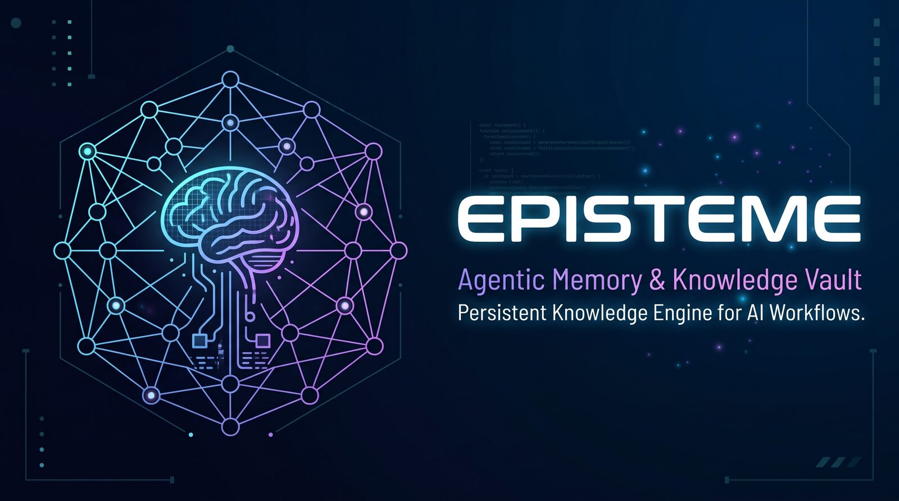
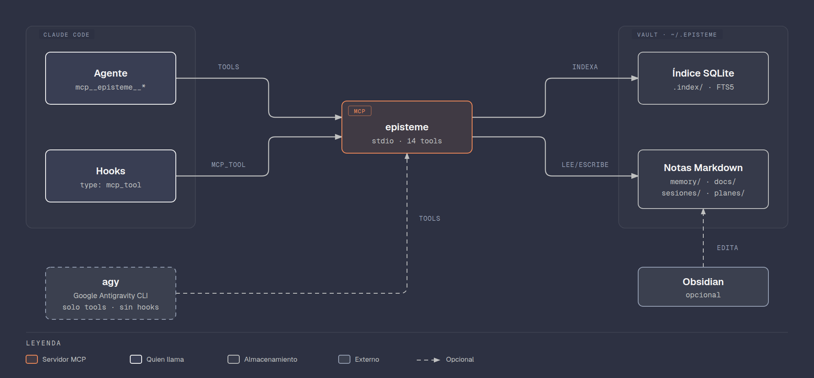
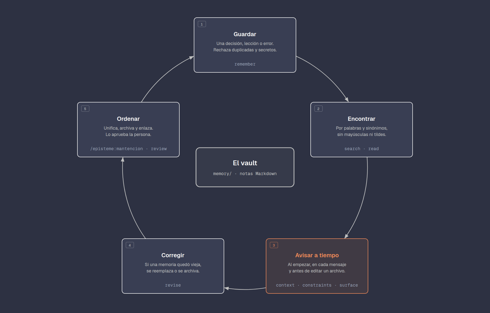
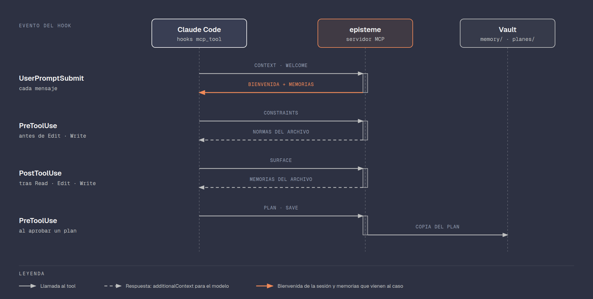
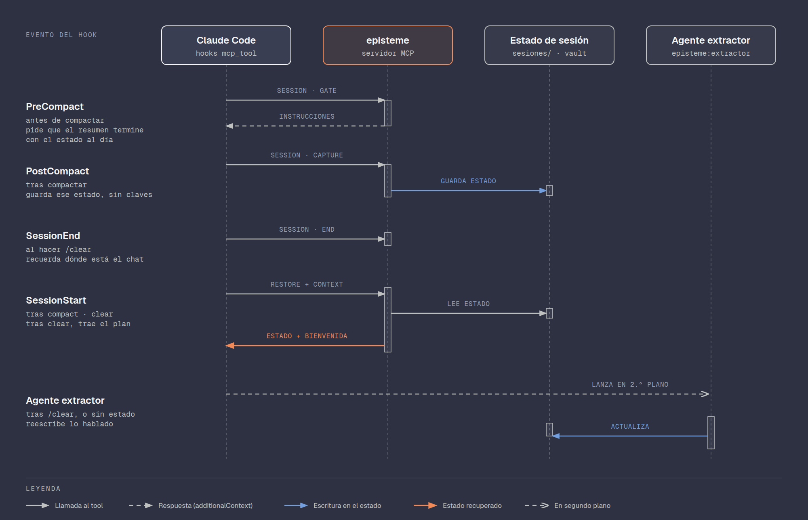

<div align="center">



<a href="https://github.com/Bajmein/episteme/tags"></a>
<a href="https://www.python.org/"></a>
<a href="https://docs.astral.sh/uv/"></a>
<a href="https://github.com/modelcontextprotocol/python-sdk"></a>
<a href="https://www.sqlite.org/fts5.html"></a>
<a href="https://obsidian.md/"></a>
<a href="https://www.markdownguide.org/"></a>
<a href="https://codescene.io/projects/87754"></a>
<a href="LICENSE"></a>
<br>
<a href="#installation"></a>
<a href="#installation"></a>
<a href="#installation"></a>
<br>
<a href="https://github.com/Bajmein/episteme/actions/workflows/ci.yml"></a>

# episteme

**One curated project memory for all your agents.**

</div>

<p align="center">
  <a href="README.md">Español</a> · <b>English</b>
</p>

<p align="center">
  <a href="#what-it-is">What it is</a> ·
  <a href="#how-it-works">How it works</a> ·
  <a href="#which-agents-it-works-with">Agents</a> ·
  <a href="#installation">Installation</a> ·
  <a href="#daily-use">Daily use</a> ·
  <a href="#the-9-tools">Tools</a> ·
  <a href="#limits">Limits</a> ·
  <a href="#documentation">Documentation</a>
</p>

---

> [!NOTE]
> This is the English translation of the [README in Spanish](README.md). The documents in `docs/` are in Spanish.

## What it is

Claude Code and agy (Google Antigravity, with Gemini) share the same memories through episteme. An AI agent is like a brilliant colleague who arrives every morning remembering nothing about yesterday: it starts each session without knowing what happened in the last one. **episteme gives it a memory that lasts**: a folder of Markdown notes (the *vault*) that holds the decisions, lessons and documentation of your projects, and that your agents read and add to as they work. What one learns, the other finds.

| | What it does for you |
| :-- | :-- |
| **Remembers** | Saves decisions, lessons, errors and preferences as notes, organized by project |
| **Finds** | Searches the whole vault, in Spanish, ignoring case and accents |
| **Warns in time** | Before a file is edited, shows the rules that apply to it; afterwards, what is already known about it |
| **Picks up where you left off** | Keeps a live note of what you are working on, updates it by itself after compacting or `/clear`, and brings it back when you continue |
| **Saves your plans** | Copies every plan you approve in plan mode and, if you clear the context when approving it, tells Claude where it is |
| **Keeps the documentation current** | With `/episteme-docs:docs`, downloads the pages of the third-party documentation stored in the vault and updates only those that changed |
| **Keeps things tidy** | Detects duplicates, expired memories, broken links and unlinked memories; refuses to save passwords and tokens |

The notes are your own text files: open them with [Obsidian](https://obsidian.md/) or any editor. They do not depend on any external service.

**Your information stays on your machine.** The memories, the index and the activity log live on your computer, and the server does not connect to the network. The only network use is the installation (downloaded from GitHub) and `/episteme-docs:docs`, if you use it.

> [!NOTE]
> **Current version: v0.21.0.** Works on Linux, macOS and Windows. What is new in each version is in the [CHANGELOG](CHANGELOG.md) (in Spanish).

## How it works

<p align="center">
  
</p>

1. **Claude Code** talks to episteme in two ways: the agent uses its tools when it needs them, and the *hooks* call them automatically at fixed moments of the session. **agy** (Google Antigravity CLI) uses the same tools and the same memories, but without hooks.
2. **episteme** is a small program that runs on your machine. It is the only door to the vault: it validates what is saved and keeps an index for fast search.
3. **The vault** is a folder of Markdown notes, by default `~/.episteme`. You can read and edit it with Obsidian.

<details>
<summary><b>Quick glossary</b></summary>

| Term | What it means |
| :-- | :-- |
| **Vault** | The folder with all the notes. It is split into zones: memories, documentation, session state and plans |
| **Memory** | A short note with something worth remembering: a decision, a lesson, a reminder |
| **Tool** | An action Claude can ask episteme for: search, read, save |
| **Hook** | A Claude Code automation that calls a tool without anyone asking |
| **MCP** | The standard protocol Claude Code uses to connect to programs like episteme |

</details>

## Which agents it works with

The tools work with any MCP client. The automations (the hooks) belong to Claude Code.

| | Claude Code | agy | Other MCP client |
| :-- | :-: | :-: | :-: |
| Tools (search, read, save) | Yes | Yes | Yes |
| Welcome when the session starts | Yes | No | No |
| Memory suggestions with each message | Yes | No | No |
| Rules before editing a file | Yes | No | No |
| Notices after reading or editing a file | Yes | No | No |
| Continuity after `/compact` and `/clear` | Yes | No | No |
| Copy of your plans | Yes | No | No |

In agy and other clients, the agent uses the tools when you ask or when a rule tells it to. Other agents, such as Codex or Copilot, are not promised.

## Installation

**You need** [uv](https://docs.astral.sh/uv/) and git. uv gets Python for you if it is missing.

### Option A · With the skill (recommended)

The skills come in a Claude Code plugin. It is installed once per machine, with two commands (the same on Linux, macOS and Windows):

```bash
claude plugin marketplace add Bajmein/episteme
claude plugin install episteme@episteme
```

More details (updating, removing) in the [installation guide](docs/instalacion.md#los-plugins) (in Spanish).

Then, in each project you want to connect:

1. Restart Claude Code and open it at the project root.
2. Type `/episteme:setup`.
3. Approve the changes it shows you. The skill registers the server, sets up the hooks and permissions, and adds the rule to `CLAUDE.md`.

The plugin also brings these skills:

| Skill | What for |
| :-- | :-- |
| `/episteme:sesion` | Save where you are (`guardar`) and pick it up later (`retomar`) |
| `/episteme:mantencion` | Review the memories with you: merge repeated ones, resolve contradictions and archive expired ones. With `corta` it does a quick round of 3 cases; with `huerfanas`, it links memories left on their own |
| `/episteme:reminder <text>` | Leave a reminder that appears at the start of each session of the project |
| `/episteme:scaffold` | Create or review the project base: `README.md`, `CLAUDE.md`, `CHANGELOG.md`, contribution rules and `.gitignore`. With `auditar` it only reviews, changing nothing. It also warns when the README or `CLAUDE.md` have gone a while without review |
| `/episteme-docs:docs [suite]` | Update the third-party documentation stored in the vault's `docs/` (all suites, or only the one you name, such as `claude code`): downloads the pages, shows what changed and saves it. It comes in a separate, optional plugin: `claude plugin install episteme-docs@episteme` |
| `/episteme:agy [task]` | Enable agy (Google Antigravity CLI) in the project and hand it tasks. Claude reviews what agy proposes to remember |

The plugin also works with agy, without the automations: no hooks and no automatic welcome (see «agy» in [Installation](docs/instalacion.md#agy-opcional), in Spanish).

### Option B · By hand

A single command registers the server. Replace `<project>` with your project's name.

**Linux and macOS**

```bash
claude mcp add --scope local episteme -- \
  uvx --from git+https://github.com/Bajmein/episteme@v0.21.0 episteme --project <project>
```

**Windows** (PowerShell, on a single line)

```powershell
claude mcp add --scope local episteme -- uvx --from git+https://github.com/Bajmein/episteme@v0.21.0 episteme --project <project>
```

The hooks, the permissions and the `CLAUDE.md` rule are still missing: the steps are in the [installation guide](docs/instalacion.md#después-de-registrar) (in Spanish).

> [!TIP]
> To check that it worked, `claude mcp list` should show `episteme` connected. The first time takes a while, because it downloads. To update, repeat the registration with the new tag.

## Daily use

There are no commands to learn: you use it by talking to Claude. Each memory goes through a cycle: it is saved, found when needed, warns in time and, when it gets old, is corrected or tidied up.

<p align="center">
  
</p>

| You | episteme |
| :-- | :-- |
| Start a session | Gives Claude the project's rules, the due reminders and the most important memories |
| Write a message | Suggests the memories that are relevant |
| Say «remember that…» | Saves a new memory, unless an almost identical one exists |
| Ask «what did we decide about…?» | Claude searches the vault before answering |
| Claude is about to edit a file | Shows it the rules that apply to that file |
| Approve a plan in plan mode | Saves a copy of the plan; if you choose to clear the context, tells Claude where it is |
| The conversation is compacted or you clear it with `/clear` | Recovers the work state and updates it in the background with what was discussed. If you are about to compact by hand without having saved it, it warns you once |

### What happens by itself in each session

<p align="center">
  
</p>

Hooks never block Claude or decide for it: they only bring it context. They work like a traffic light, not a wall: Claude can read the rule and still get it wrong. The configuration is in [Hooks](docs/hooks.md) (in Spanish).

#### When compacting or with `/clear`

<p align="center">
  
</p>

When compacting you do not have to do anything: the summary Claude writes ends with the work state and episteme saves it. A new session does not load the previous one's work: it tells you in one line that it exists and you pick it up with `/episteme:sesion retomar`. The detail is in [Session state](docs/sesion.md) (in Spanish).

#### The rest: who does what

| When | Who | What happens |
| :-- | :-- | :-- |
| At the first welcome, at most once per period | episteme | Warns about what is pending review and proposes a short round; if you enable it, archives what has expired and makes a backup |
| When it needs to | Claude | Searches, reads, saves («remember that…») and corrects memories |
| When you ask | you | `/episteme:mantencion` to review and tidy up |

Saving a memory is always Claude's decision: no hook copies what you write. episteme does not check the vault in the background: the review runs when someone asks for it.

## The 9 tools

| Tool | What it is for | Writes |
| :-- | :-- | :-: |
| `search` | Search the notes and memories | |
| `read` | Read a note, a section or several notes at once, and see which notes link to it | |
| `context` | Give the session welcome, gather what is relevant for a task and show what is known about a file and the rules that apply to it | ● |
| `remember` | Save a new memory, with a one-line description if you like; can link it by itself to similar memories and warns if keywords or links are missing | ● |
| `revise` | Correct, replace or archive a note | ● |
| `review` | Review the vault: duplicates, expired, broken links and loose memories, with suggestions of what to link them to | |
| `session` | Save and pick up the session state (goal, what is done, next step), with a template | ● |
| `plan` | Save a copy of each plan-mode plan and point to it after «clear context» (the hooks use it) | ● |
| `docs` | See the documentation suites and save a downloaded page (used by `/episteme-docs:docs`) | ● |

`docs` only appears if the vault has documentation suites; without them there are 8. The parameters and exact behavior of each one are in [Tools and memories](docs/tools.md) (in Spanish).

### Memory types

| Type | What it holds |
| :-- | :-- |
| `decision` | Something that was decided and why |
| `constraint` | A rule to respect when touching certain files |
| `lesson` | Something learned worth repeating or avoiding |
| `error` | A failure and how it was solved |
| `preference` | How the person likes to work |
| `insight` | A finding or a conclusion |
| `reminder` | Something pending, with a date |
| `session` | The work state: saving it, recovering it and what the hooks do when compacting |

Each memory has a priority from 1 to 5: priority-5 memories are the rules Claude sees at the start of every session.

## Limits

- **Search by curated keywords, not by embeddings.** «marketing» does not find a note that only says «mkt»: that is why each memory carries `keywords` with synonyms and acronyms, which Claude adds when saving. An embeddings model (bge-m3) was tested with 147 real queries and only 3 found anything new; the measurement is in [Development](docs/desarrollo.md#medir-si-los-embeddings-aportan) (in Spanish).
- **It warns, it does not force.** The rules reach Claude in time, but nothing stops it from ignoring them.
- **It does not tidy itself.** Merging repeated memories and resolving contradictions is for you to approve, with `/episteme:mantencion`. It is worth enabling `archive_expired = true` (see [Maintenance](docs/mantencion.md), in Spanish).
- **The password filter knows the usual formats.** A key with an unusual format may get through: do not dictate secrets.

## Documentation

The technical detail lives in [`docs/`](docs/), in Spanish:

| Document | Contents |
| :-- | :-- |
| [Installation](docs/instalacion.md) (in Spanish) | Manual steps on Linux, macOS and Windows, and the plugin with the skills |
| [Configuration](docs/configuracion.md) (in Spanish) | Server arguments, variables, `episteme.toml`, zones and the activity log |
| [Tools and memories](docs/tools.md) (in Spanish) | The 9 tools with their parameters, the memory schema and the errors |
| [Session state](docs/sesion.md) (in Spanish) | The live note of each thread of work in `sesiones/`, its template and when it is archived |
| [Plans](docs/planes.md) (in Spanish) | The copy of each plan-mode plan in `planes/`, how it is recovered after «clear context» and when it is archived |
| [Documentation suites](docs/documentacion.md) (in Spanish) | Third-party documentation in the vault's `docs/` and how it is kept current with `/episteme-docs:docs` |
| [Hooks](docs/hooks.md) (in Spanish) | The block for `settings.json`, the recommended permissions and how to check they work |
| [Maintenance](docs/mantencion.md) (in Spanish) | Warnings, archiving of expired memories, backup and the review cycle |
| [OMEGA migration](docs/migracion-omega.md) (in Spanish) | How to bring over the OMEGA memories |
| [Development](docs/desarrollo.md) (in Spanish) | Tests, lint, code health and measurement scripts |
| [CHANGELOG](CHANGELOG.md) (in Spanish) | Changes in each version |

## Development

```bash
uv sync            # install the dependencies
uv run ruff check  # lint
uv run pytest      # tests
```

The rest (the full CI lint, the quality review of each PR with CodeScene and the measurement scripts) is in [Development](docs/desarrollo.md) (in Spanish).

## License

[MIT](LICENSE), © 2026 Kenno ([benjamincriado.dev](https://benjamincriado.dev/episteme/)).
