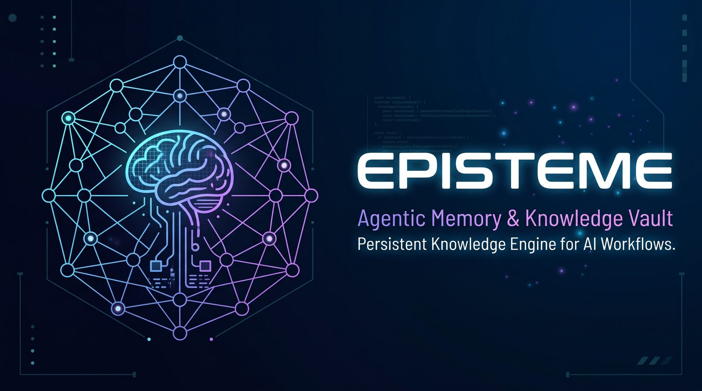
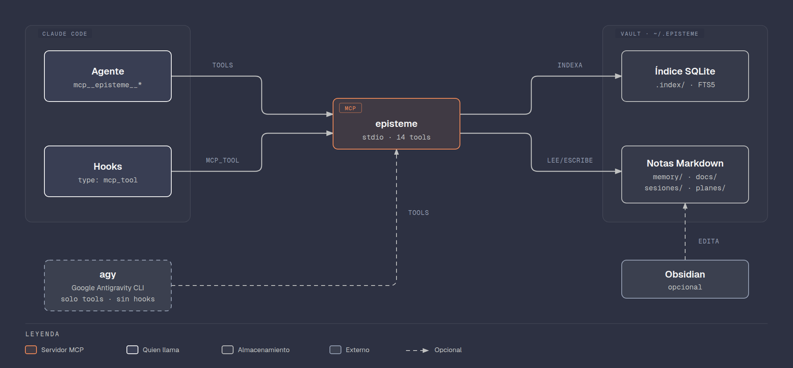

<div align="center">



[](https://github.com/Bajmein/episteme/actions/workflows/ci.yml)
[](https://github.com/Bajmein/episteme/tags)
[](https://www.python.org/)
[](https://docs.astral.sh/uv/)
[](https://github.com/modelcontextprotocol/python-sdk)
[](https://www.sqlite.org/fts5.html)
[](https://obsidian.md/)
[](#instalación)

# episteme

**Documentación y memoria de proyectos para agentes, servida por MCP desde un vault Markdown**

</div>

<p align="center">
  <a href="#qué-es">Qué es</a> ·
  <a href="#cómo-funciona">Cómo funciona</a> ·
  <a href="#instalación">Instalación</a> ·
  <a href="#uso-diario">Uso diario</a> ·
  <a href="#las-10-herramientas">Herramientas</a> ·
  <a href="#documentación">Documentación</a>
</p>

---

## Qué es

Claude Code empieza cada sesión sin recordar la anterior. **episteme le da una memoria que dura**: una carpeta de notas en Markdown (el *vault*) donde quedan las decisiones, las lecciones y la documentación de tus proyectos, y que Claude consulta y completa mientras trabaja.

| | Qué hace por ti |
| :-- | :-- |
| **Recuerda** | Guarda decisiones, lecciones, errores y preferencias como notas ordenadas por proyecto |
| **Encuentra** | Busca en todo el vault, en español, sin distinguir mayúsculas ni tildes |
| **Avisa a tiempo** | Antes de editar un archivo, muestra las normas que le aplican; después, lo que ya se sabe de él |
| **Retoma** | Guarda en qué ibas antes de que la conversación se compacte y lo recupera después |
| **Cuida el orden** | Detecta duplicados, memorias vencidas y enlaces rotos; rechaza guardar contraseñas y tokens |

Las notas son archivos de texto tuyos: se abren con [Obsidian](https://obsidian.md/) o con cualquier editor, y no dependen de ningún servicio externo.

> [!NOTE]
> **Versión actual: v0.10.0.** Funciona en Linux, macOS y Windows. Las novedades de cada versión están en el [CHANGELOG](CHANGELOG.md).

## Cómo funciona

<p align="center">
  
</p>

1. **Claude Code** habla con episteme de dos formas: el agente usa sus herramientas cuando las necesita, y los *hooks* las llaman solos en momentos fijos de la sesión.
2. **episteme** es un programa pequeño que corre en tu máquina. Es la única puerta al vault: valida lo que se guarda y mantiene un índice para buscar rápido.
3. **El vault** es una carpeta de notas Markdown, por defecto `~/.episteme`. Tú puedes leerlo y editarlo con Obsidian.

<details>
<summary><b>Glosario rápido</b></summary>

| Término | Qué significa |
| :-- | :-- |
| **Vault** | La carpeta con todas las notas. Se divide en zonas: documentación, memorias, planes |
| **Memoria** | Una nota corta con algo que vale la pena recordar: una decisión, una lección, un recordatorio |
| **Herramienta (tool)** | Una acción que Claude puede pedirle a episteme: buscar, leer, guardar |
| **Hook** | Un automatismo de Claude Code que llama a una herramienta sin que nadie lo pida |
| **MCP** | El protocolo estándar con el que Claude Code se conecta a programas como episteme |

</details>

## Instalación

**Necesitas** [uv](https://docs.astral.sh/uv/), git y ser colaborador del repo `Bajmein/episteme` (es privado). uv consigue Python por ti si falta.

### Opción A · Con la skill (recomendada)

Las skills vienen en un plugin de Claude Code. Se instala una vez por máquina, con dos comandos (igual en Linux, macOS y Windows):

```bash
claude plugin marketplace add Bajmein/episteme
claude plugin install episteme@episteme
```

Más detalles (repo privado, actualizar, quitar) en la [guía de instalación](docs/instalacion.md#el-plugin).

Después, en cada proyecto que quieras conectar:

1. Reinicia Claude Code y ábrelo en la raíz del proyecto.
2. Escribe `/episteme:setup`.
3. Aprueba los cambios que te muestra. La skill registra el servidor, configura los hooks y los permisos, y añade la regla al `CLAUDE.md`.

El plugin trae además estas skills:

| Skill | Para qué |
| :-- | :-- |
| `/episteme:pausa` | Guardar en qué estabas antes de `/clear` o de cerrar, y retomarlo después con `/episteme:pausa retomar` |
| `/episteme:mantencion` | Revisar las memorias contigo: unificar las repetidas, resolver contradicciones y archivar lo vencido |
| `/episteme:reminder <texto>` | Dejar un recordatorio que sale al empezar cada sesión del proyecto |

### Opción B · A mano

Un solo comando registra el servidor. Cambia `<proyecto>` por el nombre del tuyo.

**Linux y macOS**

```bash
claude mcp add --scope local episteme -- \
  uvx --from git+ssh://git@github.com/Bajmein/episteme@v0.10.0 episteme --project <proyecto>
```

**Windows** (PowerShell, en una sola línea)

```powershell
claude mcp add --scope local episteme -- uvx --from git+https://github.com/Bajmein/episteme@v0.10.0 episteme --project <proyecto>
```

Luego faltan los hooks, los permisos y la regla del `CLAUDE.md`: los pasos están en la [guía de instalación](docs/instalacion.md#después-de-registrar).

> [!TIP]
> Para comprobar que quedó bien, `claude mcp list` debe mostrar `episteme` conectado. La primera vez tarda un poco, porque se descarga. Para actualizar, repite el registro con el tag nuevo.

## Uso diario

No hay comandos que aprender: se usa conversando con Claude.

| Tú | episteme |
| :-- | :-- |
| Empiezas una sesión | Le entrega a Claude las normas del proyecto, los recordatorios vencidos y las memorias más importantes |
| Escribes un mensaje | Sugiere las memorias que vienen al caso |
| Dices «recuerda que…» | Guarda una memoria nueva, salvo que ya exista una casi igual |
| Preguntas «¿qué decidimos sobre…?» | Claude busca en el vault antes de responder |
| Claude va a editar un archivo | Le muestra las normas que aplican a ese archivo |
| La conversación se compacta | Guarda el estado del trabajo y lo recupera al seguir |

### Lo que pasa solo en cada sesión

<p align="center">
  
</p>

Los hooks nunca bloquean a Claude ni deciden por él: solo le acercan contexto. La configuración está en [Hooks](docs/hooks.md).

## Las 10 herramientas

| Herramienta | Para qué sirve | Escribe |
| :-- | :-- | :-: |
| `search` | Buscar en las notas y las memorias | |
| `read` | Leer una nota, una sección o varias notas a la vez | |
| `links` | Ver qué notas enlazan con otra | |
| `context` | Dar la bienvenida de la sesión y reunir lo relevante para una tarea | ● |
| `surface` | Mostrar lo que se sabe de un archivo | |
| `constraints` | Mostrar las normas que aplican a un archivo | |
| `remember` | Guardar una memoria nueva | ● |
| `revise` | Corregir, reemplazar o archivar una nota | ● |
| `review` | Revisar el vault: duplicados, vencidas, enlaces rotos | |
| `checkpoint` | Guardar y recuperar el estado del trabajo | ● |

Los parámetros y el comportamiento exacto de cada una están en [Tools y memorias](docs/tools.md).

### Tipos de memoria

| Tipo | Qué guarda |
| :-- | :-- |
| `decision` | Algo que se decidió y por qué |
| `constraint` | Una norma que hay que respetar al tocar ciertos archivos |
| `lesson` | Algo aprendido que conviene repetir o evitar |
| `error` | Un fallo y cómo se resolvió |
| `preference` | Cómo le gusta trabajar a la persona |
| `insight` | Un hallazgo o una conclusión |
| `reminder` | Algo pendiente, con fecha |
| `session` | El estado del trabajo, guardado al compactar |

Cada memoria lleva una prioridad del 1 al 5: las de prioridad 5 son las normas que Claude ve al empezar cada sesión.

## Documentación

El detalle técnico vive en [`docs/`](docs/):

| Documento | Contenido |
| :-- | :-- |
| [Instalación](docs/instalacion.md) | Pasos a mano en Linux, macOS y Windows, y el plugin con las skills |
| [Configuración](docs/configuracion.md) | Argumentos del servidor, variables, `episteme.toml`, zonas y registro de actividad |
| [Tools y memorias](docs/tools.md) | Las 10 herramientas con sus parámetros, el esquema de las memorias y los errores |
| [Hooks](docs/hooks.md) | El bloque para `settings.json`, los permisos recomendados y cómo comprobar que funcionan |
| [Mantención](docs/mantencion.md) | Avisos, archivado de memorias vencidas, backup y el ciclo de revisión |
| [Migración de OMEGA](docs/migracion-omega.md) | Cómo traer las memorias de OMEGA |
| [Desarrollo](docs/desarrollo.md) | Tests, lint, salud del código y scripts de medición |
| [CHANGELOG](CHANGELOG.md) | Cambios de cada versión |

## Desarrollo

```bash
uv sync            # instala las dependencias
uv run ruff check  # lint
uv run pytest      # tests
```

El resto (el lint completo del CI, la revisión de calidad de cada PR con CodeScene y los scripts de medición) está en [Desarrollo](docs/desarrollo.md).
