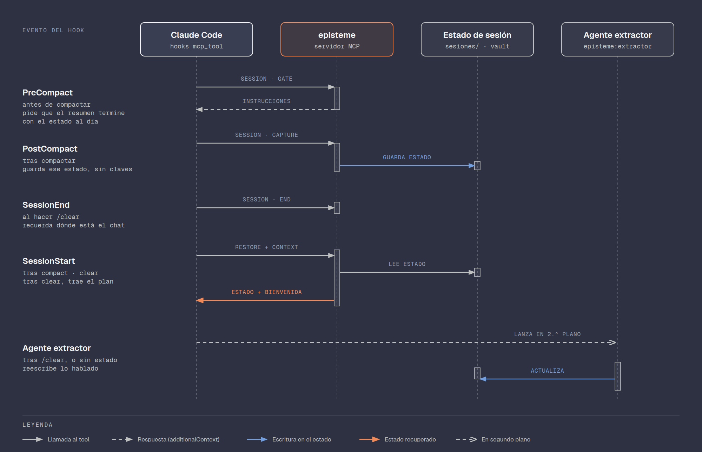

<div align="center">


<a href="https://github.com/Bajmein/episteme/tags"></a>
<a href="https://www.python.org/"></a>
<a href="https://docs.astral.sh/uv/"></a>
<a href="https://github.com/modelcontextprotocol/python-sdk"></a>
<a href="https://www.sqlite.org/fts5.html"></a>
<a href="https://obsidian.md/"></a>
<a href="https://www.markdownguide.org/"></a>
<a href="https://codescene.io/projects/87754"></a>
<a href="LICENSE"></a>
<br>
<a href="#instalación"></a>
<a href="#instalación"></a>
<a href="#instalación"></a>
<br>
<a href="https://github.com/Bajmein/episteme/actions/workflows/ci.yml"></a>
<a href="https://codecov.io/gh/Bajmein/episteme"></a>

# episteme

**Una sola memoria de proyecto, curada, para todos tus agentes.**

</div>

<p align="center">
  <b>Español</b> · <a href="README.en.md">English</a>
</p>

<p align="center">
  <a href="#qué-es">Qué es</a> ·
  <a href="#cómo-funciona">Cómo funciona</a> ·
  <a href="#instalación">Instalación</a> ·
  <a href="#uso-diario">Uso diario</a> ·
  <a href="#las-9-herramientas">Herramientas</a> ·
  <a href="#límites">Límites</a> ·
  <a href="#documentación">Documentación</a>
</p>

---

## Qué es

Un agente de IA es como un colega brillante que cada mañana llega sin recordar nada de ayer. **episteme le da una memoria que dura**: una carpeta de notas en Markdown (el *vault*) donde quedan las decisiones, las lecciones y la documentación de tus proyectos. Claude Code y agy (Google Antigravity, con Gemini) comparten las mismas memorias, y cada una anota qué agente la guardó.

| | Qué hace por ti |
| :-- | :-- |
| **Recuerda** | Guarda decisiones, lecciones, errores y preferencias, por proyecto |
| **Encuentra** | Busca en todo el vault, en español, sin importar mayúsculas ni tildes |
| **Avisa a tiempo** | Muestra las normas de un archivo antes de editarlo |
| **Retoma** | Guarda en qué vas y lo recupera tras compactar, `/clear` o al seguir |
| **Guarda tus planes** | Copia cada plan que apruebas en plan mode |
| **Mantiene la documentación al día** | Actualiza la documentación de terceros con `/episteme-docs:docs` |
| **Cuida el orden** | Detecta duplicados, vencidas y enlaces rotos; rechaza contraseñas y tokens |

**Tus notas son archivos Markdown tuyos y no salen de tu máquina** (se abren con [Obsidian](https://obsidian.md/) o cualquier editor). La única red es la instalación, desde GitHub, y `/episteme-docs:docs`, si la usas.

> [!NOTE]
> **Versión actual: v0.22.1.** Funciona en Linux, macOS y Windows. Las novedades de cada versión están en el [CHANGELOG](CHANGELOG.md).

## Cómo funciona

<p align="center">
  
</p>

1. **Claude Code** usa las herramientas de episteme cuando las necesita, y sus *hooks* las llaman solos en momentos fijos de la sesión. **agy** usa las mismas herramientas, sin hooks.
2. **episteme** es un programa pequeño que corre en tu máquina. Es la única puerta al vault: valida lo que se guarda y mantiene un índice para buscar rápido.
3. **El vault** es una carpeta de notas Markdown, por defecto `~/.episteme`. Tú puedes leerlo y editarlo con Obsidian.

<details>
<summary><b>Glosario rápido</b></summary>

| Término | Qué significa |
| :-- | :-- |
| **Vault** | La carpeta con todas las notas. Se divide en zonas: memorias, documentación, estado de las sesiones y planes |
| **Memoria** | Una nota corta con algo que vale la pena recordar: una decisión, una lección, un recordatorio |
| **Herramienta (tool)** | Una acción que Claude puede pedirle a episteme: buscar, leer, guardar |
| **Hook** | Un automatismo de Claude Code que llama a una herramienta sin que nadie lo pida |
| **MCP** | El protocolo estándar con el que Claude Code se conecta a programas como episteme |

</details>

### Con qué agentes funciona

| | Claude Code | agy | Otro cliente MCP |
| :-- | :-: | :-: | :-: |
| Herramientas (buscar, leer, guardar) | Sí | Sí | Sí |
| Automatismos: bienvenida, sugerencias por mensaje, normas y avisos al tocar archivos, continuidad tras `/compact` y `/clear`, copia de planes | Sí | No | No |

En agy y en otros clientes, el agente usa las herramientas cuando se lo pides o una regla se lo indica.

## Instalación

**Necesitas** [uv](https://docs.astral.sh/uv/) y git. uv consigue Python por ti si falta.

### Opción A · Con la skill (recomendada)

Una vez por máquina, igual en Linux, macOS y Windows ([más detalles](docs/instalacion.md#los-plugins)):

```bash
claude plugin marketplace add Bajmein/episteme
claude plugin install episteme@episteme
```

Después, en cada proyecto que quieras conectar:

1. Reinicia Claude Code y ábrelo en la raíz del proyecto.
2. Escribe `/episteme:setup`.
3. Aprueba los cambios que te muestra: registra el servidor, configura hooks y permisos, y añade la regla al `CLAUDE.md`.

| Skill | Para qué |
| :-- | :-- |
| `/episteme:setup` | Conectar el proyecto: servidor, hooks, permisos y regla del `CLAUDE.md` |
| `/episteme:sesion` | Guardar en qué estás (`guardar`) y retomarlo (`retomar`) |
| `/episteme:mantencion` | Revisar memorias contigo; `corta` hace una ronda rápida y `huerfanas` enlaza las sueltas |
| `/episteme:reminder <texto>` | Dejar un recordatorio que sale al empezar cada sesión |
| `/episteme:scaffold` | Crear o revisar `README.md`, `CLAUDE.md`, `CHANGELOG.md` y `.gitignore`; con `auditar` solo revisa |
| `/episteme:agy [tarea]` | Activar agy en el proyecto y pasarle tareas |
| `/episteme-docs:docs [suite]` | Poner al día la documentación de terceros. Plugin aparte, opcional: `claude plugin install episteme-docs@episteme` |

Las skills también cargan en agy, incluida `/episteme-docs:docs`, pero sin hooks ni bienvenida automática (ver «agy» en [Instalación](docs/instalacion.md#agy-opcional)).

<details>
<summary><b>Opción B · A mano (sin la skill)</b></summary>

Un solo comando registra el servidor. Cambia `<proyecto>` por el nombre del tuyo.

**Linux y macOS**

```bash
claude mcp add --scope local episteme -- \
  uvx --from git+https://github.com/Bajmein/episteme@v0.22.1 episteme --project <proyecto>
```

**Windows** (PowerShell, en una sola línea)

```powershell
claude mcp add --scope local episteme -- uvx --from git+https://github.com/Bajmein/episteme@v0.22.1 episteme --project <proyecto>
```

Luego faltan los hooks, los permisos y la regla del `CLAUDE.md`: están en la [guía de instalación](docs/instalacion.md#después-de-registrar).

</details>

> [!TIP]
> Para comprobarlo, `claude mcp list` debe mostrar `episteme` conectado. La primera vez tarda, porque se descarga. Para actualizar, repite el registro con el tag nuevo.

## Uso diario

No hay comandos que aprender: se usa conversando con Claude.

<p align="center">
  
</p>

| Tú | episteme |
| :-- | :-- |
| Empiezas una sesión | Entrega las normas, los recordatorios vencidos y las memorias más importantes |
| Escribes un mensaje | Sugiere las memorias que vienen al caso |
| Dices «recuerda que…» | Guarda una memoria nueva, salvo que ya exista una casi igual |
| Preguntas «¿qué decidimos sobre…?» | Claude busca en el vault antes de responder |
| Claude va a editar un archivo | Le muestra las normas de ese archivo |
| Apruebas un plan en plan mode | Guarda una copia y, si limpias el contexto, dice dónde quedó |
| Compactas o usas `/clear` | Recupera el estado del trabajo y lo pone al día en segundo plano |
| Pides `/episteme:mantencion` | Revisa contigo duplicados, contradicciones y vencidas |

<details>
<summary><b>Qué hacen los hooks en cada sesión</b></summary>

<p align="center">
  
</p>

Los hooks nunca bloquean a Claude ni deciden por él: solo le acercan contexto. Configuración en [Hooks](docs/hooks.md).

<p align="center">
  
</p>

Al compactar no tienes que hacer nada: episteme guarda el estado del trabajo. Una sesión nueva te avisa de que existe y lo retomas con `/episteme:sesion retomar`. Detalle en [Estado de la sesión](docs/sesion.md).

</details>

## Las 9 herramientas

| Herramienta | Para qué sirve | Escribe |
| :-- | :-- | :-: |
| `search` | Buscar en las notas y las memorias | |
| `read` | Leer notas y ver qué otras notas las enlazan | |
| `context` | Dar la bienvenida, reunir lo relevante para una tarea y mostrar las normas de un archivo | ● |
| `remember` | Guardar una memoria nueva, enlazada con las parecidas | ● |
| `revise` | Corregir, reemplazar o archivar una nota sin perder cambios | ● |
| `review` | Revisar el vault: duplicados, vencidas, enlaces rotos y memorias sueltas | |
| `session` | Guardar y retomar el estado de la sesión | ● |
| `plan` | Guardar una copia de cada plan de plan mode (la usan los hooks) | ● |
| `docs` | Ver las suites de documentación y guardar una página (lo usa `/episteme-docs:docs`) | ● |

`docs` solo aparece si el vault tiene suites de documentación; sin ellas son 8. Cada memoria tiene un tipo (decisión, norma, lección, error, preferencia, hallazgo o recordatorio) y una prioridad del 1 al 5: las de prioridad 5 son las normas que Claude ve al empezar. Detalle en [Tools y memorias](docs/tools.md#memorias).

## Límites

- **Búsqueda por palabras clave, no por embeddings.** «marketing» no encuentra «mkt»: por eso cada memoria lleva `keywords` con sinónimos. Con bge-m3 y 147 consultas reales, solo 3 encontraron algo nuevo ([medición](docs/desarrollo.md#medir-si-los-embeddings-aportan)).
- **Avisa, no obliga.** Las normas llegan a Claude a tiempo, pero nada le impide ignorarlas.
- **No se ordena solo.** Unificar y resolver contradicciones lo apruebas tú, con `/episteme:mantencion`. Conviene activar `archive_expired = true` ([Mantención](docs/mantencion.md)).
- **El filtro de contraseñas conoce los formatos habituales.** Una clave rara puede pasar: no dictes secretos.

## Documentación

| Documento | Contenido |
| :-- | :-- |
| [Instalación](docs/instalacion.md) | Pasos a mano en Linux, macOS y Windows, y el plugin |
| [Configuración](docs/configuracion.md) | Argumentos, variables, `episteme.toml` y registro de actividad |
| [Tools y memorias](docs/tools.md) | Las 9 herramientas, el esquema de las memorias y los errores |
| [Estado de la sesión](docs/sesion.md) | La nota viva de cada hilo de trabajo en `sesiones/` |
| [Planes](docs/planes.md) | La copia de cada plan y cómo se recupera tras «clear context» |
| [Suites de documentación](docs/documentacion.md) | Documentación de terceros en el vault y `/episteme-docs:docs` |
| [Hooks](docs/hooks.md) | El bloque para `settings.json` y los permisos recomendados |
| [Mantención](docs/mantencion.md) | Avisos, archivado, backup y ciclo de revisión |
| [Migración de OMEGA](docs/migracion-omega.md) | Cómo traer las memorias de OMEGA |
| [Desarrollo](docs/desarrollo.md) | Tests, lint, salud del código y scripts de medición |
| [CHANGELOG](CHANGELOG.md) | Cambios de cada versión |

¿Vas a contribuir? Tests y lint en [Desarrollo](docs/desarrollo.md); los agentes ya tienen sus instrucciones en [`CLAUDE.md`](CLAUDE.md) (Claude Code) y [`GEMINI.md`](GEMINI.md) (agy).

## Licencia

[MIT](LICENSE), © 2026 Kenno ([benjamincriado.dev](https://benjamincriado.dev/episteme/)).
