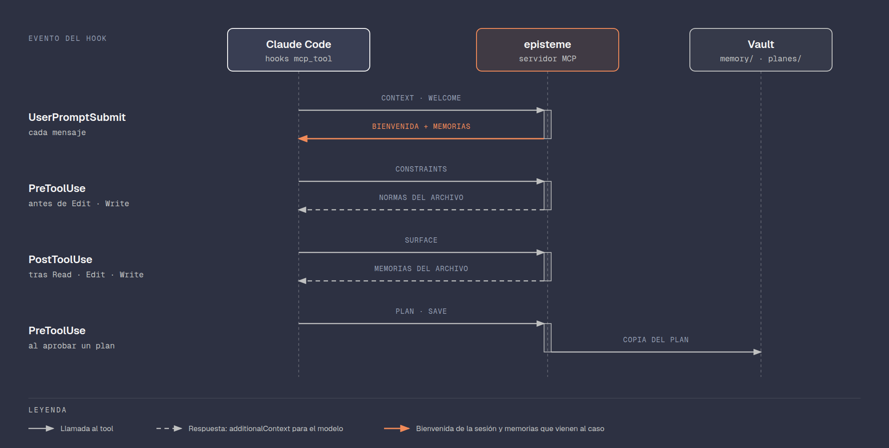

<div align="center">


<a href="https://github.com/Bajmein/episteme/tags"></a>
<a href="https://www.python.org/"></a>
<a href="LICENSE"></a>
<a href="https://github.com/Bajmein/episteme/actions/workflows/ci.yml"></a>
<a href="https://codecov.io/gh/Bajmein/episteme"></a>

# episteme

**Una sola memoria de proyecto, curada, para todos tus agentes.**

<b>Español</b> · <a href="README.en.md">English</a>

</div>

---

## Qué es

Un agente de IA es como un colega brillante que cada mañana llega sin recordar nada de ayer. **episteme le da una memoria que dura**: una carpeta de notas en Markdown (el *vault*) con las decisiones, las lecciones y la documentación de tus proyectos. Claude Code y agy (Google Antigravity, con Gemini) comparten las mismas memorias.

| | Qué hace por ti |
| :-- | :-- |
| **Recuerda** | Decisiones, lecciones, errores y preferencias, por proyecto |
| **Encuentra** | Busca en todo el vault, sin importar mayúsculas ni tildes |
| **Avisa a tiempo** | Muestra las normas de un archivo antes de editarlo |
| **Retoma** | Recupera en qué ibas tras compactar o `/clear` |
| **Guarda tus planes** | Copia cada plan que apruebas |
| **Cuida el orden** | Detecta duplicados y vencidas; rechaza contraseñas |

**Tus notas son archivos Markdown tuyos y no salen de tu máquina** (se abren con [Obsidian](https://obsidian.md/) o cualquier editor). Solo usa la red al instalar y con `/episteme-docs:docs`, si la usas.

> [!NOTE]
> **Versión actual: v0.22.1.** Funciona en Linux, macOS y Windows. Las novedades, en el [CHANGELOG](CHANGELOG.md).

### Cómo funciona

<p align="center">
  
</p>

episteme es un programa pequeño que corre en tu máquina y es la única puerta al vault: valida lo que se guarda y lo indexa para buscar rápido. Los agentes lo usan con sus herramientas; en Claude Code, además, los *hooks* lo llaman solos en momentos fijos.

| | Claude Code | agy | Otro cliente MCP |
| :-- | :-: | :-: | :-: |
| Herramientas (buscar, leer, guardar) | Sí | Sí | Sí |
| Automatismos (hooks) | Sí | No | No |

<details>
<summary><b>Glosario rápido</b></summary>

| Término | Qué significa |
| :-- | :-- |
| **Vault** | La carpeta con todas las notas: memorias, documentación, sesiones y planes |
| **Memoria** | Una nota corta con algo que vale la pena recordar |
| **Herramienta (tool)** | Una acción que Claude le pide a episteme: buscar, leer, guardar |
| **Hook** | Un automatismo de Claude Code que llama a una herramienta sin que nadie lo pida |
| **MCP** | El protocolo con el que Claude Code se conecta a programas como episteme |

</details>

## Instalación

**Necesitas** [uv](https://docs.astral.sh/uv/) y git. uv consigue Python si falta.

### Opción A · Con la skill (recomendada)

Una vez por máquina, igual en Linux, macOS y Windows ([más detalles](docs/instalacion.md#los-plugins)):

```bash
claude plugin marketplace add Bajmein/episteme
claude plugin install episteme@episteme
```

Después, en cada proyecto:

1. Reinicia Claude Code y ábrelo en la raíz del proyecto.
2. Escribe `/episteme:setup`.
3. Aprueba los cambios: registra el servidor, configura hooks y permisos, y añade la regla al `CLAUDE.md`.

> [!TIP]
> `claude mcp list` debe mostrar `episteme` conectado. La primera vez tarda, porque se descarga. Para actualizar, repite el registro con el tag nuevo.

<details>
<summary><b>Opción B · A mano (sin la skill)</b></summary>

Un solo comando registra el servidor. Cambia `<proyecto>` por el nombre del tuyo.

**Linux y macOS**

```bash
claude mcp add --scope local episteme -- \
  uvx --from git+https://github.com/Bajmein/episteme@v0.22.1 episteme --project <proyecto>
```

**Windows** (PowerShell, en una sola línea)

```powershell
claude mcp add --scope local episteme -- uvx --from git+https://github.com/Bajmein/episteme@v0.22.1 episteme --project <proyecto>
```

Faltan los hooks, los permisos y la regla del `CLAUDE.md`: están en la [guía de instalación](docs/instalacion.md#después-de-registrar).

</details>

## Uso diario

No hay comandos que aprender: se usa conversando con Claude.

<p align="center">
  
</p>

| Tú | episteme |
| :-- | :-- |
| Empiezas una sesión | Entrega las normas, los recordatorios y las memorias clave |
| Escribes un mensaje | Sugiere las memorias que vienen al caso |
| Dices «recuerda que…» | Guarda una memoria, salvo que ya exista una casi igual |
| Preguntas «¿qué decidimos sobre…?» | Claude busca en el vault antes de responder |
| Claude va a editar un archivo | Le muestra las normas de ese archivo |
| Apruebas un plan | Guarda una copia y dice dónde quedó tras limpiar el contexto |
| Compactas o usas `/clear` | Recupera el estado del trabajo |

Para algunas tareas hay atajos:

| Atajo | Para qué |
| :-- | :-- |
| `/episteme:sesion` | Guardar en qué estás (`guardar`) y retomarlo (`retomar`) |
| `/episteme:mantencion` | Revisar contigo duplicados, contradicciones y vencidas |
| `/episteme:reminder <texto>` | Dejar un recordatorio para cada sesión |
| `/episteme:scaffold` | Crear o revisar `README.md`, `CLAUDE.md` y `CHANGELOG.md` |
| `/episteme:agy [tarea]` | Activar agy y pasarle tareas |
| `/episteme-docs:docs [suite]` | Poner al día la documentación de terceros (plugin aparte: `claude plugin install episteme-docs@episteme`) |

Las skills también cargan en agy, pero sin hooks ni bienvenida automática ([agy](docs/instalacion.md#agy-opcional)).

Por dentro, Claude usa 9 herramientas: buscar, leer, guardar, corregir, revisar y otras. Cada memoria tiene un tipo (decisión, norma, lección…) y una prioridad del 1 al 5; las de 5 son las normas que Claude ve al empezar. Detalle en [Tools y memorias](docs/tools.md#memorias).

<details>
<summary><b>Qué hacen los hooks en cada sesión</b></summary>

<p align="center">
  
</p>

Los hooks nunca bloquean a Claude ni deciden por él: solo le acercan contexto. Configuración en [Hooks](docs/hooks.md).

<p align="center">
  
</p>

Al compactar, episteme guarda el estado del trabajo; en una sesión nueva lo retomas con `/episteme:sesion retomar`. Detalle en [Estado de la sesión](docs/sesion.md).

</details>

## Límites

- **Busca por palabras, no por significado.** «marketing» no encuentra «mkt»: por eso cada memoria lleva `keywords` con sinónimos. Con bge-m3 y 147 consultas reales, solo 3 encontraron algo nuevo ([medición](docs/desarrollo.md#medir-si-los-embeddings-aportan)).
- **Avisa, no obliga.** Las normas llegan a tiempo, pero Claude puede ignorarlas.
- **No se ordena solo.** Unificar y resolver contradicciones lo apruebas tú, con `/episteme:mantencion` ([Mantención](docs/mantencion.md)).
- **El filtro de contraseñas no es perfecto.** Conoce los formatos habituales: no dictes secretos.

## Documentación

| Documento | Contenido |
| :-- | :-- |
| [Instalación](docs/instalacion.md) | A mano, el plugin y agy |
| [Configuración](docs/configuracion.md) | Argumentos, variables y `episteme.toml` |
| [Tools y memorias](docs/tools.md) | Las herramientas, las memorias y los errores |
| [Estado de la sesión](docs/sesion.md) | Retomar el trabajo tras compactar o `/clear` |
| [Planes](docs/planes.md) | La copia de cada plan |
| [Suites de documentación](docs/documentacion.md) | Documentación de terceros en el vault |
| [Hooks](docs/hooks.md) | Configuración y permisos |
| [Mantención](docs/mantencion.md) | Archivado, backup y revisión |
| [Migración de OMEGA](docs/migracion-omega.md) | Traer las memorias de OMEGA |
| [Desarrollo](docs/desarrollo.md) | Tests, lint, CI y release |
| [CHANGELOG](CHANGELOG.md) | Cambios de cada versión |

## Licencia

[MIT](LICENSE), © 2026 Kenno ([benjamincriado.dev](https://benjamincriado.dev/episteme/)).
