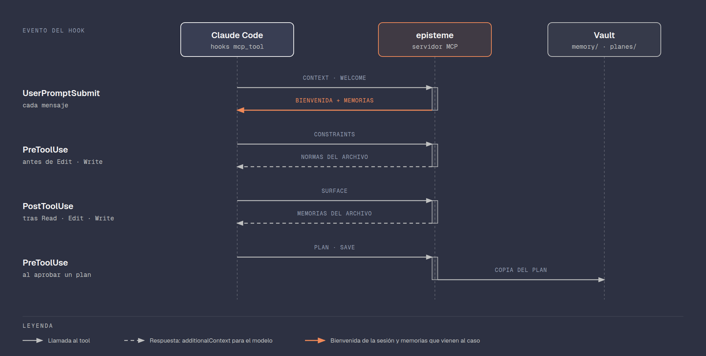

# Hooks

[← Volver al README](../README.md)



Los hooks son `type: "mcp_tool"` y llaman a los mismos tools. En `UserPromptSubmit`, `SessionStart`, `PreToolUse` y `PostToolUse` el tool devuelve el objeto JSON `{"hookSpecificOutput": {"hookEventName", "additionalContext"}}` (en Claude Code 2.1.322 el texto plano de un hook `mcp_tool` no llega al modelo); en `PreCompact`, nada. Sin nada que decir, la salida es una cadena vacía. Nunca devuelve `decision`, `permissionDecision` ni `continue: false`.

Bloque para el `settings.json` del proyecto:

```json
{
  "hooks": {
    "UserPromptSubmit": [
      { "hooks": [{ "type": "mcp_tool", "server": "episteme", "tool": "context",
                    "input": { "mode": "welcome", "session": "${session_id}",
                               "prompt": "${prompt}",
                               "hook_event": "${hook_event_name}" } }] }
    ],
    "PreToolUse": [
      { "matcher": "Edit|Write|mcp__serena__.*",
        "hooks": [{ "type": "mcp_tool", "server": "episteme", "tool": "constraints",
                    "input": { "file": "${tool_input.file_path}",
                               "relative_path": "${tool_input.relative_path}",
                               "project_dir": "${cwd}",
                               "hook_event": "${hook_event_name}" } }] }
    ],
    "PostToolUse": [
      { "matcher": "Read|Edit|Write|mcp__serena__.*",
        "hooks": [{ "type": "mcp_tool", "server": "episteme", "tool": "surface",
                    "input": { "file": "${tool_input.file_path}",
                               "relative_path": "${tool_input.relative_path}",
                               "project_dir": "${cwd}",
                               "hook_event": "${hook_event_name}",
                               "session": "${session_id}" } }] }
    ],
    "PreCompact": [
      { "hooks": [{ "type": "mcp_tool", "server": "episteme", "tool": "checkpoint",
                    "input": { "action": "save", "project_dir": "${cwd}",
                               "hook_event": "${hook_event_name}" } }] }
    ],
    "SessionStart": [
      { "matcher": "compact|clear",
        "hooks": [{ "type": "mcp_tool", "server": "episteme", "tool": "checkpoint",
                    "input": { "action": "restore", "project_dir": "${cwd}",
                               "hook_event": "${hook_event_name}" } },
                  { "type": "mcp_tool", "server": "episteme", "tool": "context",
                    "input": { "mode": "welcome", "session": "${session_id}",
                               "hook_event": "${hook_event_name}" } }] }
    ]
  }
}
```

Si el servidor va empaquetado en un plugin, `server` pasa a ser el nombre con scope (`plugin:fabrik:episteme`).

Permisos recomendados: `allow` para los tools de consulta (`mcp__episteme__search`, `read`, `links`, `review`, `context`, `surface` y `constraints`; `context` no es de solo lectura solo porque su primera bienvenida puede correr la mantención) y `deny` de `Read` y `Edit` sobre la ruta del vault (`Read(~/.episteme/**)`, `Edit(~/.episteme/**)`; `Edit` ya cubre Write), para que el agente solo use los tools. El [`settings.json`](../skills/episteme-setup/settings.json) de la skill `episteme-setup` trae los hooks y los permisos juntos, listos para fusionar. Tras actualizar la skill, pídele la comprobación de configuración: lista lo que falta o está repetido en los tres `settings` sin tocar nada hasta que apruebes el diff.

## Comprobar que los hooks llegan al modelo

Con una copia del vault de prueba, una llamada real a Claude Code confirma que el contexto del hook llega al modelo (el recordatorio vencido del vault de prueba contiene «trigger queries»). En zsh, desde la raíz del repo:

```zsh
W=$(mktemp -d) && cp -r tests/fixtures/vault "$W/vault" && mkdir "$W/work"
print -r -- "{\"mcpServers\":{\"episteme\":{\"command\":\"uv\",\"args\":[\"run\",\"--directory\",\"$PWD\",\"episteme\",\"--vault\",\"$W/vault\",\"--project\",\"fabrik\"],\"env\":{\"EPISTEME_TODAY\":\"2026-10-22\"}}}}" > "$W/mcp.json"
uv run python -c 'import json,sys; d=json.load(open("skills/episteme-setup/settings.json", encoding="utf-8")); json.dump({"hooks": d["hooks"]}, open(sys.argv[1], "w", encoding="utf-8"))' "$W/settings.json"
(cd "$W/work" && claude -p "Según el contexto que te dio episteme al empezar, ¿cuál es el título del recordatorio vencido? Responde solo con el título, o NINGUNO si no lo ves." --model haiku --settings "$W/settings.json" --mcp-config "$W/mcp.json" --strict-mcp-config --output-format json < /dev/null)
```

El campo `result` debe contener «trigger queries»; «NINGUNO» significa que el hook no llegó (o que el servidor no conectó a tiempo: repite una vez). Con varias cuentas se usa el lanzador de la cuenta (`claude-<cuenta> -p`).
